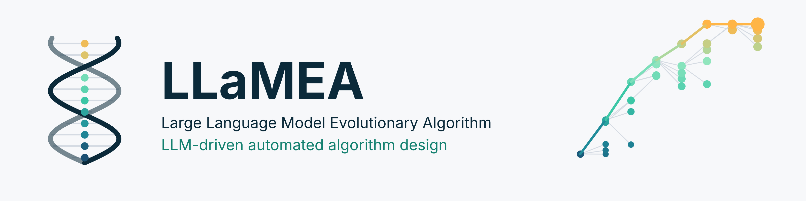
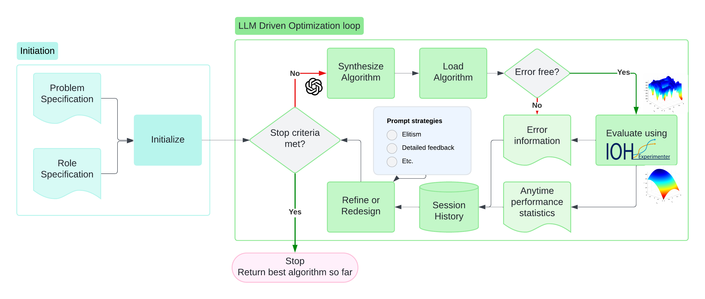

<p align="center">
  <picture>
    <source media="(prefers-color-scheme: dark)" srcset="docs/media/llamea-banner-dark.png">
    <source media="(prefers-color-scheme: light)" srcset="docs/media/llamea-banner.png">
    
  </picture>
</p>

> ⭐ If you like this, please give the repo a star – it helps!

<p align="center">
  <a href="https://pypi.org/project/llamea/"></a>
  <a href="https://pypi.org/project/llamea/"></a>
  
  <a href="LICENSE"></a>
  <a href="https://github.com/XAI-liacs/LLaMEA/actions/workflows/test.yml"></a>
  <a href="https://codecov.io/gh/XAI-liacs/LLaMEA"></a>
  
</p>
<p align="center">
  <a href="https://xai-liacs.github.io/LLaMEA/"></a>
  <a href="https://doi.org/10.1109/TEVC.2024.3497793"></a>
  <a href="https://doi.org/10.5281/zenodo.13842144"></a>
  <a href="https://www.human-competitive.org/awards"></a>
  <a href="https://github.com/XAI-liacs/BLADE"></a>
  <a href="https://colab.research.google.com/github/XAI-liacs/LLaMEA/blob/main/docs/notebooks/simple_example.ipynb"></a>
  <a href="https://github.com/astral-sh/uv"></a>
  <a href="https://github.com/psf/black"></a>
</p>

> **The fully open alternative to Google DeepMind's AlphaEvolve for automated algorithm discovery.**
> First released 📅 Nov 2024 • MIT License • 100 % reproducible • 🥈 Silver [Humies 2025](https://www.human-competitive.org/awards) at GECCO.

LLaMEA couples large-language-model reasoning with an evolutionary loop to
**invent, mutate and benchmark algorithms fully autonomously**: the LLM writes
code, your evaluation function scores it, and the feedback drives the next
generation.

> [!TIP]
> **LLaMEA designs algorithms; [BLADE](https://github.com/XAI-liacs/BLADE) benchmarks them.**
> To compare LLaMEA (or a variant) with other LLM-driven design methods such
> as EoH, ReEvo, FunSearch or MCTS-AHD on standard problems, with logging,
> plots and a web app, run it through BLADE. See
> [Running experiments with BLADE](#-running-experiments-with-blade).
> Documentation: [xai-liacs.github.io/LLaMEA](https://xai-liacs.github.io/LLaMEA/).

## Table of Contents
- [News](#-news)
- [Introduction](#introduction)
- [LLaMEA variants](#-llamea-variants)
- [Installation](#-installation)
- [Quick Start](#-quick-start)
- [Running experiments with BLADE](#-running-experiments-with-blade)
- [Configuration](#-configuration)
- [Examples](#-examples)
- [Publications](#-publications)
- [Awards](#-awards)
- [Reproducibility](#-reproducibility)
- [Contributing](#-contributing)
- [License](#-license)
- [Citation](#-citation)

## 🔥 News

+ 2026.11 ✨ **LLaMEA v1.6.0**: ready-made variants `LLaMEA_HPO`, `LLaMEA_BO`, `LLaMEA_MO` and `LLaMEA_SAGE`, adaptive operator selection that now really adapts, and a round of bug fixes ([changelog](CHANGELOG.md)).
+ 2026.11 ✨ **[BLADE v1.2](https://github.com/XAI-liacs/BLADE)**: benchmark LLaMEA against other methods from a single YAML file.
+ 2026.08 📄 ["Evolving Executable Pipeline Programs for AutoML with Language Models"](https://arxiv.org/abs/2608.16416) on arXiv.
+ 2026.07 📄 ["LLM-Driven Evolutionary Generation of Multi-Objective Bayesian Optimization Algorithms"](https://arxiv.org/abs/2607.08791) on arXiv.
+ 2026.01 📄 ["LLaMEA-SAGE: Guiding Automated Algorithm Design with Structural Feedback from Explainable AI"](https://arxiv.org/abs/2601.21511) on arXiv.
+ 2025.08 🥉 **A LLaMEA-generated agent won 3rd prize at the IEEE CoG 2025 Planet Wars RTS competition.**
+ 2025.07 🥈 **LLaMEA won the Silver award at the [Humies @ GECCO 2025](https://www.human-competitive.org/awards).**
+ 2025.07 🏆 **LLaMEA won the Anytime Performance on Many-Affine BBOB competition at GECCO 2025.**
+ 2025.06 📄 ["LLaMEA-BO"](https://arxiv.org/abs/2505.21034) on arXiv.
+ 2025.05 🎉 ["Optimizing Photonic Structures with LLM-Driven Algorithm Discovery"](https://doi.org/10.1145/3712255.3734288) and ["BLADE"](https://doi.org/10.1145/3712255.3734347) at GECCO 2025.
+ 2025.04 🎉 **LLaMEA-HPO** in ACM TELO: ["In-the-loop Hyper-Parameter Optimization for LLM-Based Automated Design of Heuristics"](https://doi.org/10.1145/3731567).
+ 2025.04 🎉 ["Code Evolution Graphs"](https://doi.org/10.1145/3712256.3726328) accepted as a full paper at GECCO 2025.
+ 2025.01 🎉 **LLaMEA paper in IEEE TEVC**: ["LLaMEA: A Large Language Model Evolutionary Algorithm for Automatically Generating Metaheuristics"](https://doi.org/10.1109/TEVC.2024.3497793).

## Introduction

**LLaMEA** (Large Language Model Evolutionary Algorithm) uses LLMs such as
GPT, Gemini, Claude or local models (Ollama, LM Studio, MLX) to generate and
refine algorithms, typically optimisation heuristics, but equally ML pipelines
or any other code you can score. Candidates evolve on measured performance and
runtime feedback, so no prior algorithm-design expertise is needed.

<p align="center">
  
</p>

**Key features**

| | |
|---|---|
| 🧬 **Evolution strategies** | `(μ+λ)` and `(μ,λ)` with random, tournament or roulette parent selection |
| 🔀 **Operators** | Mutation and crossover prompts with fixed weights or adaptive selection (e.g. discounted UCB) |
| 🎛️ **LLaMEA-HPO** | In-the-loop hyper-parameter optimisation (SMAC) so the LLM focuses on structure |
| 🎯 **Multi-objective** | Pareto-based selection (non-dominated sorting + crowding) over named objectives |
| 🌱 **Diversity** | Fitness sharing, clearing, novelty search and MAP-Elites |
| 🔍 **Explainable guidance** | LLaMEA-SAGE: XGBoost + TreeSHAP on code features steer mutations |
| ✂️ **Diff mode** | SEARCH/REPLACE patches instead of full rewrites, saving tokens |
| ⚡ **Parallel & robust** | Parallel evaluation with timeouts, population-level evaluation, warm start |

**Use cases:** problem-specific optimisation algorithms, new Bayesian
optimisation algorithms for expensive problems, ML pipelines, photonic
structure design, game agents, and more.

## 🧬 LLaMEA variants

The configurations from our papers are available as ready-made classes. They
only change defaults, so any `LLaMEA` argument still works and overrides the
preset.

| Variant | What it does | Preset | Paper |
|---|---|---|---|
| `LLaMEA` | The base algorithm | `(5+5)`, mutation | [IEEE TEVC 2025](https://doi.org/10.1109/TEVC.2024.3497793) |
| `LLaMEA_HPO` | LLM writes the algorithm and its ConfigSpace; your evaluation tunes it (e.g. SMAC) | `HPO=True`, `(5+5)`, refine-or-redesign | [ACM TELO 2025](https://doi.org/10.1145/3731567) |
| `LLaMEA_BO` | Evolves complete Bayesian optimisation algorithms | `(4+16)`, crossover 0.6, budget 100, BO prompt | [arXiv:2505.21034](https://arxiv.org/abs/2505.21034) |
| `LLaMEA_MO` | Several objectives, NSGA-II-style selection, returns a Pareto front | `multi_objective=True`, `(5+10)` | – |
| `LLaMEA_SAGE` | Mutations guided by explainable-AI analysis of code features | `feature_guided_mutation=True` | [arXiv:2601.21511](https://arxiv.org/abs/2601.21511) |

```python
from llamea import LLaMEA_BO, LLaMEA_MO, get_variant

optimizer = LLaMEA_BO(evaluate, llm)                   # paper defaults
optimizer = LLaMEA_BO(evaluate, llm, budget=200)       # override any argument
optimizer = LLaMEA_MO(evaluate_mo, llm, objectives=["Distance", "Fuel"],
                      task_prompt="...")
Variant = get_variant("hpo")                           # look up by name
```

## 🎁 Installation

```bash
pip install llamea
```

> [!IMPORTANT]
> Python **3.11.5 or higher** is required, plus an API key for your LLM
> provider (or a local model via Ollama, LM Studio or MLX).

Optional extras:

```bash
pip install "llamea[feature-guidance]"   # XGBoost for LLaMEA_SAGE / feature_guided_mutation (~290 MB)
pip install llamea-lite                  # slim install without bundled LLM / HPO dependencies
pip install iohblade                     # BLADE, to benchmark LLaMEA against other methods
```

<details>
<summary><b>From source with uv</b></summary>

```bash
git clone https://github.com/XAI-liacs/LLaMEA.git
cd LLaMEA
uv sync                            # core
uv sync --dev --group examples     # tests and example dependencies
```

Some examples need [SWIG](https://www.swig.org/download.html)
(`brew install swig` / `sudo apt-get install swig`). The plasmonic photonics
problem in `benchmarks/tuto_global_optimization_photonics` also needs
[pyGDM2](https://pypi.org/project/pyGDM2/) (`uv pip install pyGDM2`), which
requires `numpy<=2.3` and is therefore not part of any group.
</details>

## 💻 Quick Start

> [!TIP]
> Try the getting-started notebook in
> <a href="https://colab.research.google.com/github/XAI-liacs/LLaMEA/blob/main/docs/notebooks/simple_example.ipynb"></a>.

```python
from llamea import LLaMEA, OpenAI_LLM

llm = OpenAI_LLM(api_key="...", model="gpt-6.2-sol")   # or Gemini_LLM, Anthropic_LLM, Ollama_LLM, ...

def evaluate(solution, logger=None):
    # solution.code holds the generated Python code, solution.name its class name.
    namespace = {}
    exec(solution.code, namespace)
    algorithm = namespace[solution.name](budget=1000, dim=5)
    score = ...                                   # run it on your problem
    solution.set_scores(score, feedback=f"The algorithm scored {score:.3f}.")
    return solution

optimizer = LLaMEA(evaluate, llm, n_parents=4, n_offspring=8, budget=100)
best = optimizer.run()
print(best.name, best.fitness)
print(best.code)
```

`budget` is the number of generated and evaluated candidates. LLaMEA
maximises by default; pass `minimization=True` otherwise. Errors raised by the
candidate code are best caught in `evaluate` and passed on with
`solution.set_scores(score, feedback, error=e)`, so the LLM can repair them.

## 🧪 Running experiments with BLADE

[**BLADE**](https://github.com/XAI-liacs/BLADE) (Benchmarking LLM-driven
Automated Design and Evolution, [GECCO '25](https://doi.org/10.1145/3712255.3734347))
is our benchmarking platform for LLM-driven algorithm design. It runs LLaMEA,
including any variant configuration, next to other methods on built-in
problem suites (BBOB, MA-BBOB, SBOX-COST, photonics, AutoML, ...) with
isolated evaluation, the same budget for every method, seeding, logging,
plots and a results web app.

Use **LLaMEA directly** for your own problem and evaluation function; use
**BLADE** to benchmark, compare and report.

```bash
pip install iohblade
iohblade init my-exp          # starter experiment.yml
iohblade check my-exp/experiment.yml
iohblade run my-exp/experiment.yml
```

```yaml
# experiment.yml
experiment: {output_dir: results/my-exp, runs: 5, budget: 100}
llms:
  gemini: {provider: gemini, model: gemini-3.8-flash, api_key: "${env:GEMINI_API_KEY}"}
methods:
  - {type: llamea, name: "LLaMEA-{llm}", llm: gemini}
  - type: llamea                      # LLaMEA-HPO
    name: "LLaMEA-HPO-{llm}"
    llm: gemini
    params: {HPO: true, n_parents: 5, n_offspring: 5}
  - {type: random_search, name: "RS-{llm}", llm: gemini}
problems:
  - {type: bbob_sbox, name: SBOX-COST}   # supports HPO (SMAC)
```

When you run LLaMEA on its own it prints a one-line pointer to BLADE; set
`LLAMEA_NO_BLADE_HINT=1` to hide it. See the
[BLADE documentation](https://xai-liacs.github.io/BLADE/) for all problems and
methods.

## 🔧 Configuration

The most used arguments of `LLaMEA`:

| Parameter | Description |
| --- | --- |
| `n_parents`, `n_offspring`, `elitism` | Population sizes and `(μ+λ)` (default) vs. `(μ,λ)` selection |
| `budget` | Number of candidates to generate and evaluate |
| `operators`, `operator_weight_updater` | Mutation/crossover prompts (`Operator`) and adaptive operator selection |
| `parent_selection`, `tournament_size` | `"random"`, `"tournament"` or `"roulette"` |
| `role_prompt`, `task_prompt`, `example_prompt`, `output_format_prompt` | Prompt components |
| `HPO` | Ask for a ConfigSpace next to the code (LLaMEA-HPO) |
| `multi_objective`, `multi_objective_keys` | Pareto-based multi-objective mode |
| `niching` | `"sharing"`, `"clearing"`, `"novelty"` or `"map_elites"`, with related options |
| `diff_mode` | SEARCH/REPLACE patches instead of full code |
| `adaptive_mutation`, `adaptive_prompt`, `feature_guided_mutation` | Mutation-rate control, co-evolving task prompt, XAI guidance |
| `evaluate_population` | `f` receives the whole offspring population |
| `eval_timeout`, `max_workers`, `parallel_backend` | Evaluation time limit and parallelism |

See the [documentation](https://xai-liacs.github.io/LLaMEA/) for every parameter.

## 💡 Examples

| Script | Shows |
|---|---|
| [`examples/minimum_example.py`](examples/minimum_example.py) | The smallest complete set-up |
| [`examples/black-box-optimization.py`](examples/black-box-optimization.py) | Metaheuristics for the 24 BBOB functions, scored by AOCC |
| [`examples/black-box-opt-with-HPO.py`](examples/black-box-opt-with-HPO.py) | **LLaMEA-HPO** with SMAC tuning in the loop |
| [`examples/black-box-optimization-diff-mode.py`](examples/black-box-optimization-diff-mode.py) | Diff mode (SEARCH/REPLACE patches) |
| [`examples/crossover.py`](examples/crossover.py) | Mutation and crossover operators, tournament selection, discounted UCB |
| [`examples/multi_objective.py`](examples/multi_objective.py) | **LLaMEA-MO** on a vehicle-routing problem (distance and fuel) |
| [`examples/automl_example.py`](examples/automl_example.py) | Evolving ML pipelines instead of optimisers |
| [`examples/warm-start-tests.py`](examples/warm-start-tests.py) | Resuming a run from its archive |

Run any of them with `uv run python examples/<script>.py` after setting the
model and API key in the script. `benchmarks/` holds the set-ups of our papers
(MA-BBOB, photonics, mini-Bragg).

To browse the LLM conversation of a run: `uv run python logreader/app.py --logfile path/to/conversationlog.jsonl`
and open `http://localhost:5001`.

## 📚 Publications

LLaMEA is developed by the [XAI group of NACO at LIACS, Leiden University](https://naco.liacs.nl/projects/2024-llamea/)
([project page](https://naco.liacs.nl/projects/2024-llamea/), [video](https://www.youtube.com/watch?v=LtFc8K5Uc4w)).

**Methodology**
- **LLaMEA: A Large Language Model Evolutionary Algorithm for Automatically Generating Metaheuristics.** *IEEE Transactions on Evolutionary Computation* 29(2), 2025. [DOI](https://doi.org/10.1109/TEVC.2024.3497793)
- **In-the-loop Hyper-Parameter Optimization for LLM-Based Automated Design of Heuristics** (LLaMEA-HPO). *ACM Transactions on Evolutionary Learning and Optimization*, 2025. [DOI](https://doi.org/10.1145/3731567)
- **Controlling the Mutation in Large Language Models for the Efficient Evolution of Algorithms.** *EvoApplications* (Springer LNCS), 2025. [DOI](https://doi.org/10.1007/978-3-031-90065-5_25)
- **LLaMEA-BO: A Large Language Model Evolutionary Algorithm for Automatically Generating Bayesian Optimization Algorithms.** [arXiv:2505.21034](https://arxiv.org/abs/2505.21034)
- **LLaMEA-SAGE: Guiding Automated Algorithm Design with Structural Feedback from Explainable AI.** [arXiv:2601.21511](https://arxiv.org/abs/2601.21511)
- **LLM-Driven Evolutionary Generation of Multi-Objective Bayesian Optimization Algorithms.** [arXiv:2607.08791](https://arxiv.org/abs/2607.08791)
- **Large Language Models and Evolutionary Computation: A Critical Review of Bidirectional Interaction, Automated Algorithm Design, and Co-adaptive Systems.** *Computer Science Review*, 2026. [Article](https://www.sciencedirect.com/science/article/pii/S1574013726001589)

**Benchmarking & analysis**
- **BLADE: Benchmark Suite for LLM-driven Automated Design and Evolution of Iterative Optimisation Heuristics.** *GECCO '25 Companion*. [DOI](https://doi.org/10.1145/3712255.3734347) · [code](https://github.com/XAI-liacs/BLADE)
- **Code Evolution Graphs: Understanding Large Language Model Driven Design of Algorithms.** *GECCO '25*. [DOI](https://doi.org/10.1145/3712256.3726328)
- **Behaviour Space Analysis of LLM-driven Meta-heuristic Discovery.** [arXiv:2507.03605](https://arxiv.org/abs/2507.03605)
- **From Heuristic Selection to Automated Algorithm Design: LLMs Benefit from Strong Priors.** [arXiv:2603.02792](https://arxiv.org/abs/2603.02792)

**Applications**
- **Optimizing Photonic Structures with Large Language Model Driven Algorithm Discovery.** *GECCO '25 Companion*. [DOI](https://doi.org/10.1145/3712255.3734288)
- **Landscape-aware Automated Algorithm Design: An Efficient Framework for Real-world Optimization.** [arXiv:2602.04529](https://arxiv.org/abs/2602.04529)
- **LLM Driven Design of Continuous Optimization Problems with Controllable High-level Properties.** [arXiv:2601.18846](https://arxiv.org/abs/2601.18846)
- **Evolving Executable Pipeline Programs for AutoML with Language Models.** [arXiv:2608.16416](https://arxiv.org/abs/2608.16416)

## 🏆 Awards

- 🥈 **Silver award, Humies @ GECCO 2025** ([awards](https://gecco-2025.sigevo.org/Humies-Awards))
- 🏆 **Winner, Anytime Performance for Affine BBOB competition, GECCO 2025** ([results](https://gecco-2025.sigevo.org/Competition-Awards#AA4AffineBBOB_Competition))
- 🏆 **Winner, Anytime Algorithms for Many-affine BBOB Functions, GECCO 2024** ([results](https://gecco-2024.sigevo.org/Competition-Awards.html#Anytime_Algorithms_for_Many-affine_BBOB_Functions))
- 🥉 **Bronze, IEEE CoG 2025 Planet Wars RTS competition** ([results](https://simonlucas.github.io/planet-wars-rts/competitions/IEEE_CoG_2025_Results.html))

## 🔁 Reproducibility

Each paper has a Zenodo record with code, generated algorithms and logs:

* van Stein, N. (2025). BLADE – Code and Results for the paper. [doi:10.5281/zenodo.15119985](https://doi.org/10.5281/zenodo.15119985)
* van Stein, N., Vermetten, D., & Bäck, T. (2025). LLaMEA-HPO: code, generated algorithms and IOH logging data. [doi:10.5281/zenodo.14917719](https://doi.org/10.5281/zenodo.14917719)
* van Stein, N., Kononova, A. V., Kotthoff, L., & Bäck, T. (2025). Figures and code for Code Evolution Graphs. [doi:10.5281/zenodo.14770672](https://doi.org/10.5281/zenodo.14770672)
* van Stein, N., & Bäck, T. (2024). LLaMEA. [doi:10.5281/zenodo.13842144](https://doi.org/10.5281/zenodo.13842144)

## 🤝 Contributing

Contributions are welcome: report bugs or request features in
[GitHub Issues](https://github.com/XAI-liacs/LLaMEA/issues), or open a pull
request. See [CONTRIBUTING.md](CONTRIBUTING.md).

## 🪪 License

Distributed under the [MIT](LICENSE) License.

## ✨ Citation

If you use LLaMEA in your research, please cite:

```bibtex
@article{van2025llamea,
  author  = {van Stein, Niki and B{\"a}ck, Thomas},
  journal = {IEEE Transactions on Evolutionary Computation},
  title   = {LLaMEA: A Large Language Model Evolutionary Algorithm for Automatically Generating Metaheuristics},
  year    = {2025},
  volume  = {29},
  number  = {2},
  pages   = {331--345},
  doi     = {10.1109/TEVC.2024.3497793}
}
```

<details>
<summary>LLaMEA-HPO, mutation control and BLADE</summary>

```bibtex
@article{van2025intheloop,
  author  = {van Stein, Niki and Vermetten, Diederick and B{\"a}ck, Thomas},
  title   = {In-the-loop Hyper-Parameter Optimization for LLM-Based Automated Design of Heuristics},
  journal = {ACM Transactions on Evolutionary Learning and Optimization},
  year    = {2025},
  doi     = {10.1145/3731567}
}

@inproceedings{yin2025controlling,
  author    = {Yin, Haoran and Kononova, Anna V. and B{\"a}ck, Thomas and van Stein, Niki},
  title     = {Controlling the Mutation in Large Language Models for the Efficient Evolution of Algorithms},
  booktitle = {Applications of Evolutionary Computation},
  publisher = {Springer Nature Switzerland},
  year      = {2025},
  pages     = {403--417},
  doi       = {10.1007/978-3-031-90065-5_25}
}
```

For BLADE, see the [BLADE citation](https://github.com/XAI-liacs/BLADE#-citation)
([GECCO '25, doi:10.1145/3712255.3734347](https://doi.org/10.1145/3712255.3734347)).
</details>
