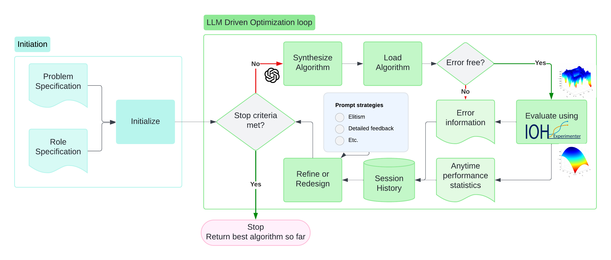

Introduction
============

**LLaMEA** (Large Language Model Evolutionary Algorithm) uses large language
models such as GPT, Gemini, Claude or local models to generate and refine
algorithms automatically: typically optimisation heuristics, but equally ML
pipelines or any other code you can score. Candidates evolve on measured
performance and runtime feedback, so no prior algorithm-design expertise is
needed.

How it works
------------

1. **Initialise**: the LLM writes ``n_parents`` algorithms from the role,
   task, example and output-format prompts.
2. **Evaluate**: your function ``f(solution, logger)`` runs each algorithm and
   sets its fitness, feedback and any error with ``solution.set_scores``.
3. **Vary**: parents are selected and an operator (mutation, crossover, ...)
   turns them into a prompt; the LLM answers with new code (or a diff).
4. **Select**: ``(μ+λ)`` or ``(μ,λ)`` survivor selection (Pareto-based for
   several objectives), optionally with niching for diversity.
5. Repeat until ``budget`` candidates have been evaluated; return the best
   solution (or the Pareto front).

Key features
------------

.. grid:: 1 2 2 2
   :gutter: 2

   .. grid-item-card:: :octicon:`git-branch` Evolution strategies & operators

      ``(μ+λ)`` / ``(μ,λ)``, random, tournament or roulette parent selection,
      weighted mutation and crossover prompts, adaptive operator selection.

   .. grid-item-card:: :octicon:`sliders` LLaMEA-HPO

      In-the-loop hyper-parameter optimisation, so the LLM focuses on
      structure rather than numbers.

   .. grid-item-card:: :octicon:`stack` Multi-objective

      Named objectives, non-dominated sorting and crowding distance, a Pareto
      archive.

   .. grid-item-card:: :octicon:`people` Diversity

      Fitness sharing, clearing, novelty search and MAP-Elites.

   .. grid-item-card:: :octicon:`eye` Explainable guidance

      LLaMEA-SAGE steers mutations with XGBoost + TreeSHAP on code features.

   .. grid-item-card:: :octicon:`diff` Diff mode & robustness

      SEARCH/REPLACE patches, parallel evaluation with timeouts, warm start.

LLaMEA and BLADE
----------------

LLaMEA is the algorithm; `BLADE <https://github.com/XAI-liacs/BLADE>`_ is the
benchmarking platform in which LLaMEA is compared with other LLM-driven
design methods on standard problems. See :doc:`blade`.
